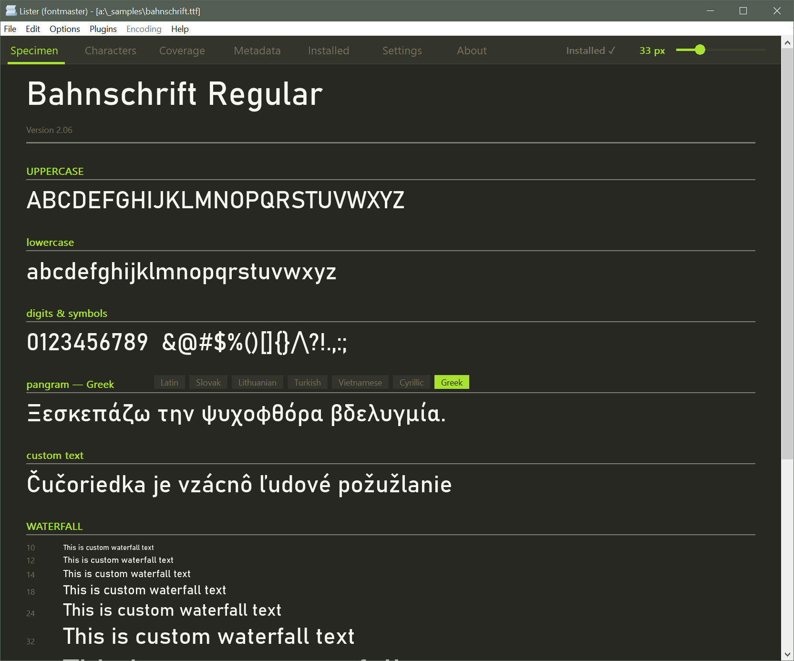
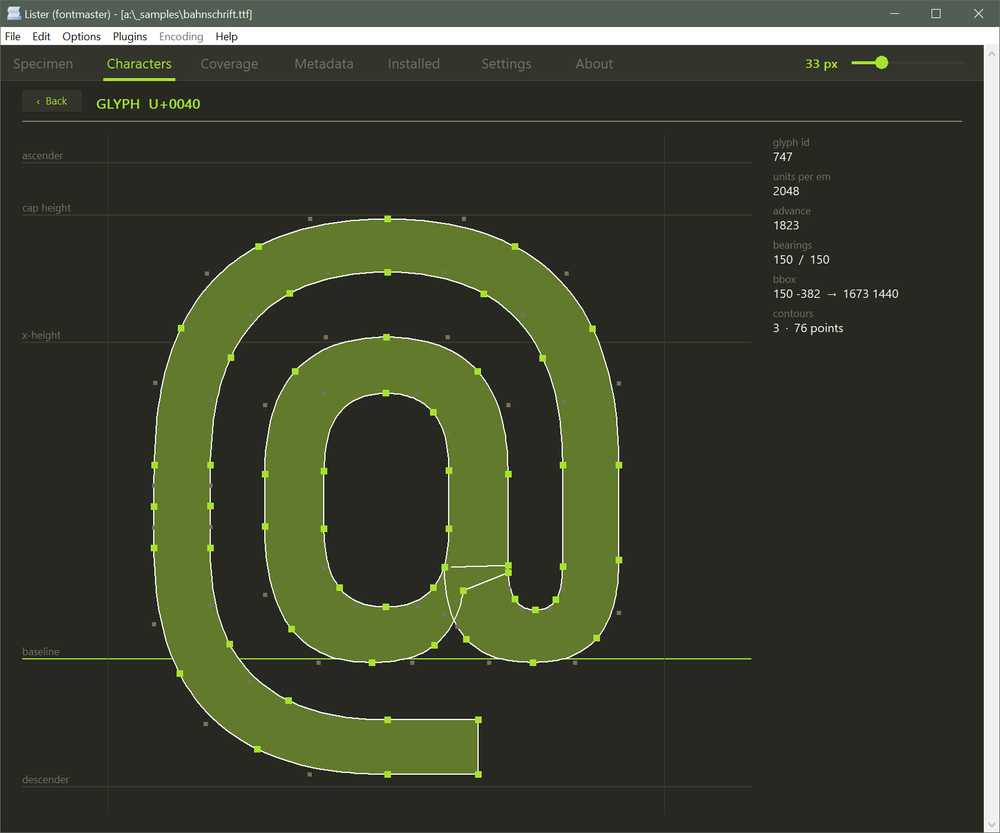
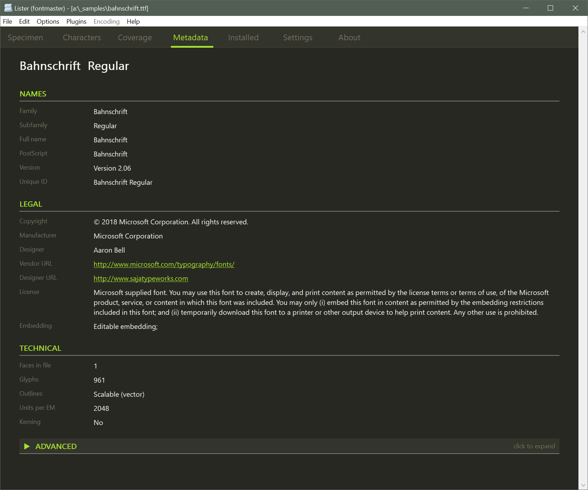
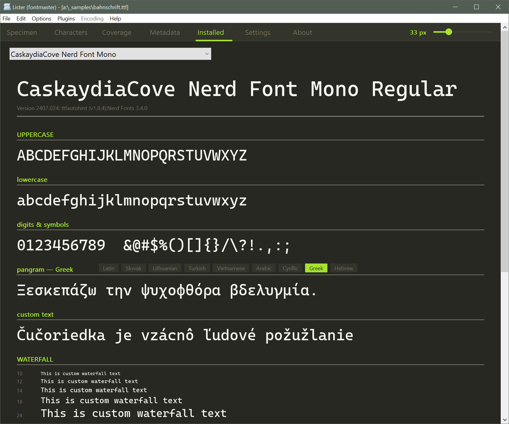
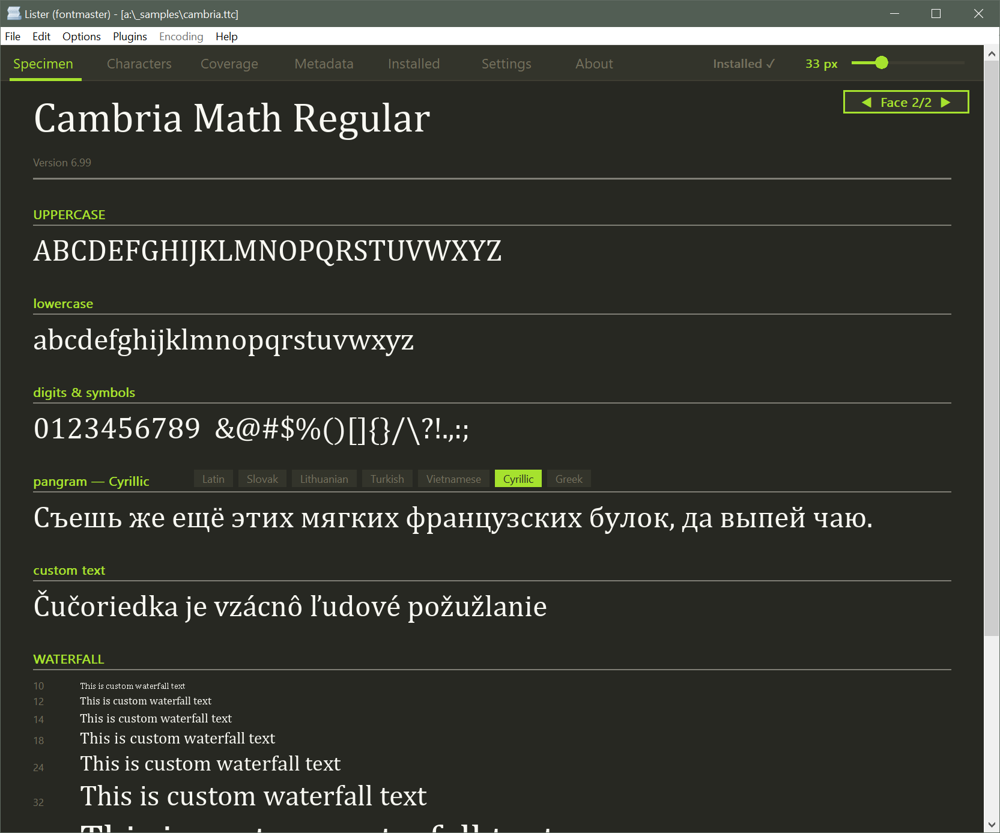
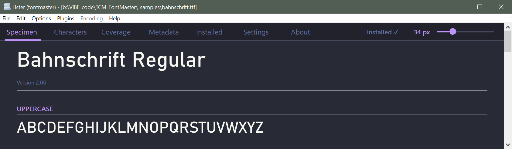
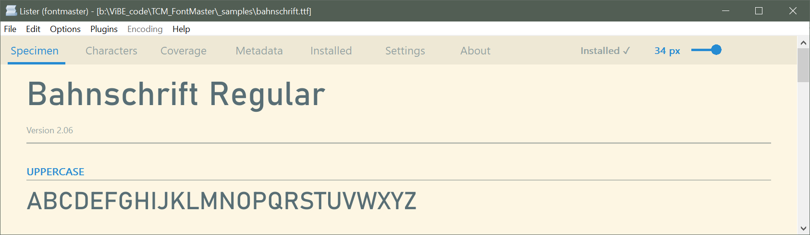

# FontMaster WLX Plugin

**FontMaster** is a modern Total Commander Lister plugin that brings font previewing directly into your file manager. Instead of opening a separate font viewer application, you can now preview fonts instantly as you browse your files - fast, clean, and built right into the workflow.

## New in version 1.5
- Glyph Inspector (double-click on glyphs)
- Pangram automatic variations to different sets, both for font, and installed fonts
- Coverage shows what writing systems this font supports

## What You Get

FontMaster is designed around one core idea: make font browsing a natural part of file management. Whether you're organizing design assets, exploring a font collection, or just checking if a font matches your needs, everything you want to know is right there without leaving Total Commander.

### Key Features

- **Live Preview**: See your fonts rendered in real-time as you navigate
- **Multi-face Support**: If a font file contains multiple typefaces (like TrueType collections), switch between them with a single click
- **Character & Glyph Inspector**: Browse every glyph the font contains, see coverage across different writing systems, and even inspect individual glyphs with a zoom view
- **Smart Specimen Samples**: Pre-built sample text for each script (Latin, Cyrillic, CJK, Arabic, etc.), with the ability to write custom preview text
- **Font Metadata**: All the details in one place - family name, style, version, licensing, and technical information
- **System Font Browser**: Check what fonts are already installed on your system and compare them side by side
- **Themes**: Choose from Light, Dark, or several carefully-selected popular themes (GitHub Light, Catppuccin, Monokai, and more)
- **Variable Font Support**: Adjust variable font axes in real-time to see how weight, width, and other parameters change the look
- **Per-User Installation**: Install fonts for your user account directly from the plugin - no administrator access needed

### Supported Font Formats

FontMaster works with all the main desktop font formats:

- TrueType (.ttf)
- OpenType (.otf)
- TrueType Collections (.ttc)
- Type 1 (.pfb with .pfm)
- Bitmap fonts (.fon, .fnt)

And it's available in both **64-bit and 32-bit versions**, so even older Windows systems are supported.

---

## Feature Walkthrough

### Specimen Preview

The specimen tab shows the font in actual use with sample text in various scripts - uppercase, lowercase, numbers, symbols, and language-specific samples. If you have a favorite preview text you want to use instead, you can set that in Settings and it will appear here. The text wraps naturally and shows you exactly how the font will look in real documents.

### Character Grid

Browse every single character in the font through an organized grid. You can navigate by Unicode blocks (Latin, Cyrillic, Greek, etc.) and see at a glance which characters are included. Click any character to see details, and if you want to dig deeper into how a specific glyph is drawn, you can double-click to open the glyph inspector.

### Glyph Inspector

For designers and font developers, the glyph inspector shows the precise outlines of individual characters. You get a pixel-perfect view of the shape, metrics, and construction of each glyph - useful when you're evaluating font quality or need to understand how a particular character is designed.

### Coverage View

Not all fonts support all languages. The coverage tab shows you exactly what writing systems this font supports - Latin, Cyrillic, Greek, Arabic, CJK, and more. You get both the percentage of coverage for each script and a helpful list of any missing characters, so you know exactly what's included and what isn't.

### Metadata & Advanced Info

Everything you'd want to know about the font is collected here. Family name, style, version, copyright, designer information, licensing terms - it's all organized into clear sections. For designers and developers, there's also an Advanced view with technical details from the font file itself. URLs in the metadata are clickable, making it easy to visit a font's website or designer page.

### Installed Fonts Browser

Want to see how this font compares to what you already have? The Installed tab lets you browse all the fonts on your system in a dropdown, and preview each one the same way. You can also install new fonts directly from here - just click the Install button and it adds the font to your user account (no admin required).

### Settings & Customization

The Settings tab keeps everything flexible. Adjust the preview size, write your own custom specimen text (useful if you're testing how a font looks with your specific words), change how the waterfall sizes work, pick your theme, and enable or disable variable font axes. It's a small tab but packs in the controls that make the preview feel just right.

### Multi-face Fonts

Some font files contain multiple typefaces. When you open a font like this, you'll see a chip in the top-right showing which face you're viewing. Use the left and right arrows (or Ctrl+PageUp/PageDown) to step through the faces. All the tabs update to show data for the currently selected face.

---

## Themes

FontMaster includes a carefully curated selection of themes to match your workflow and environment. Beyond the classic Light and Dark modes, you get several community-favorite palettes built in, and you can add your own custom themes via JSON files.

**Available themes:**

**Built-in themes:**
- Light
- Dark
- GitHub Light
- Catppuccin Latte
- Catppuccin Mocha
- Monokai
- Solarized Light
- Solarized Dark
- Nord
- Dracula
- Gruvbox Dark
- One Dark
- Tokyo Night

### Few Themes samples

Clean and readable, with high contrast for working in bright environments.

**GitHub Light** brings the familiar aesthetic of GitHub's interface - calm blues and grays that feel modern and approachable.

**Catppuccin Latte** is a warm, pastel light theme with excellent readability and a cozy feel.

Perfect for evening work or dark environments, with reduced eye strain.

**Monokai** is a dark theme with bold, vibrant accent colors - popular with developers who spend time in text editors.

**Catppuccin Mocha** and **Solarized Dark** are also available, offering different takes on dark-mode aesthetics.

All themes automatically sync with your Windows dark mode setting, or you can lock in a specific theme in Settings.

---

## Custom Specimen Text & Pangram Selection

By default, FontMaster shows intelligent, script-aware sample text - the specimen automatically picks samples in the language that best demonstrates the font's coverage (Latin, Cyrillic, Arabic, CJK, etc.). But you're not locked into defaults. 

In the **Specimen tab**, you can see a row of script chips next to "pangram" - click any chip to switch what language sample is shown. Or if you want to test how your font looks with your own text (your company name, a design slogan, whatever), just set **Custom Text** in Settings and it appears in the specimen instead.

The same feature works on the **Installed Fonts** tab - when you're browsing system fonts, you get the same script chips and custom text control, so you can compare how different fonts render your text.

---

## Behind the Scenes

FontMaster uses **FreeType** for rendering fonts and **DirectWrite** for accessing system fonts. Both are battle-tested libraries used across the industry, so you get reliable, accurate font previewing. The plugin is built natively for Windows with careful attention to performance - the preview is responsive even with large font collections.

---

## Version Info

This is FontMaster v1.5. Built with modern C++ and optimized for Windows 10+, with backward compatibility for Windows 8.1 and older systems (32-bit version).

Enjoy exploring your fonts! 🎨

