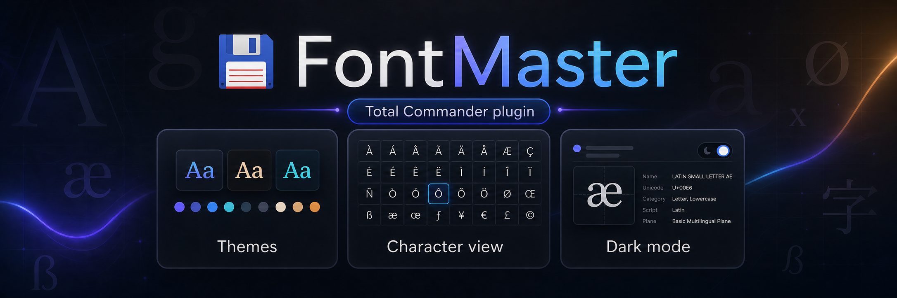
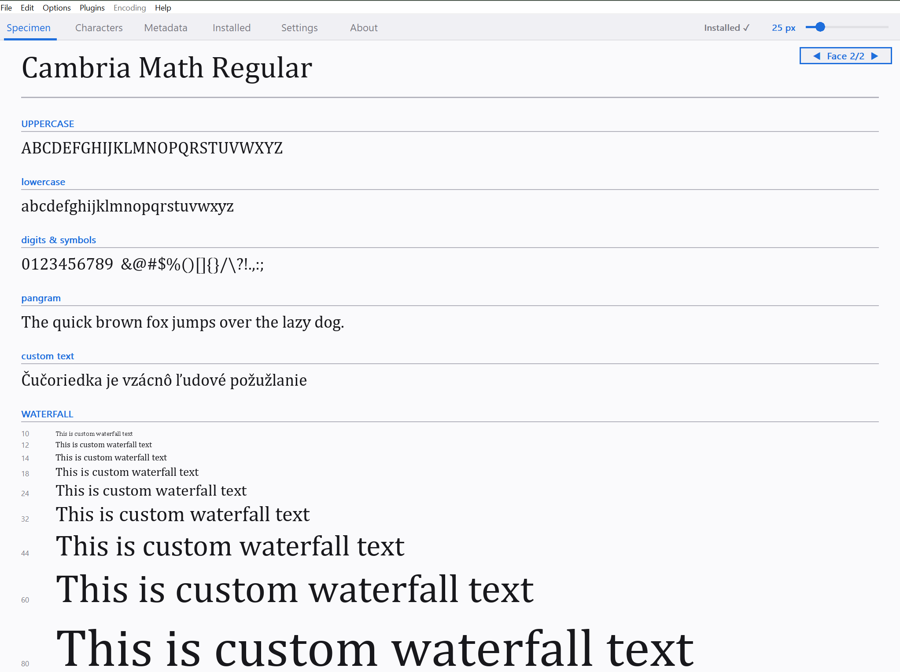
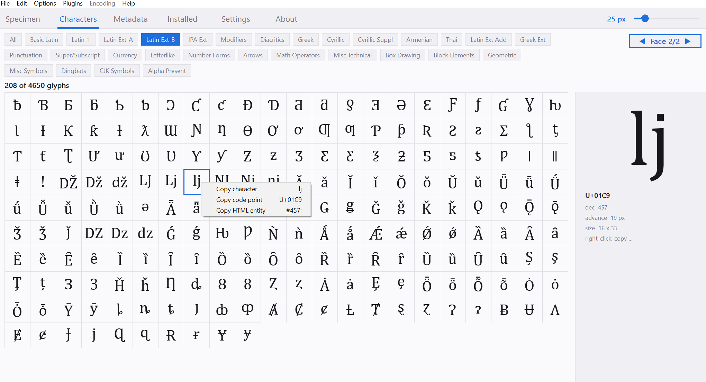
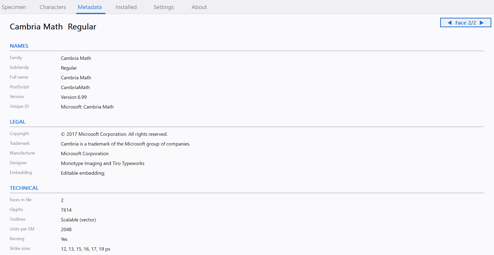
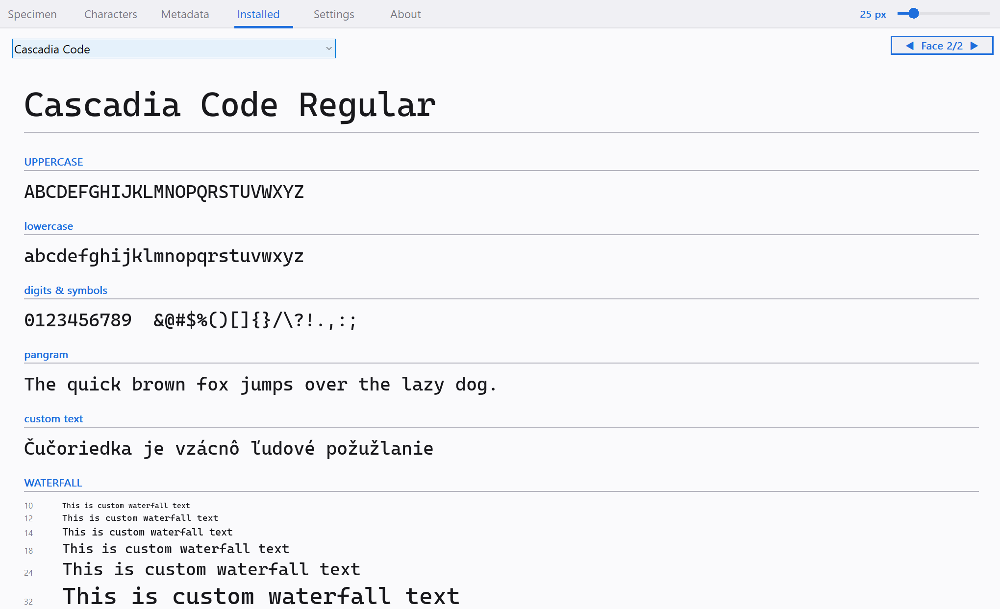
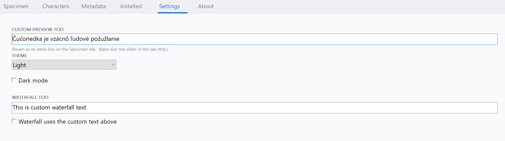
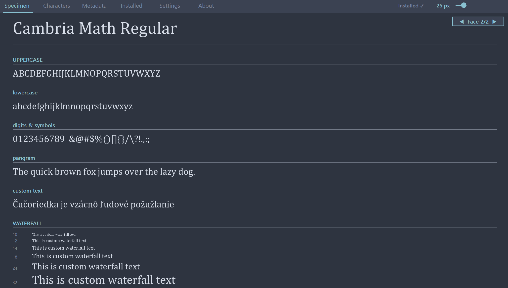

# FontMaster WLX viewer plugin

FontMaster is a modern Total Commander Lister plugin for previewing font files.

It is designed to make font browsing quick, clear, and convenient directly inside the file manager, without switching to another app.

## Overview

FontMaster gives you a focused preview of a font file, with the key details you usually want to check at a glance:

- A large specimen preview for fast visual inspection
- A character view for exploring the available glyphs
- Font metadata for family, style, and file information
- Installed font browsing for system-wide comparison
- Simple settings for preview text, size, and theme
- A clean About page with product information

## Supported font types

FontMaster supports the main desktop font formats used on Windows:

- TrueType
- OpenType
- TrueType Collections
- Type 1 fonts
- Bitmap font formats

## Screenshots

### Specimen preview

The specimen view shows the font in action with larger text, sample lines, and a clean layout for quick reading. It is the main view for checking overall style and readability.

### Character view

The character view displays the available glyphs in a grid so you can inspect individual characters, see the font coverage, and move through the font more precisely.

### Metadata

The metadata page collects the practical details in one place, including family information, style data, and other font properties that help you identify the file.

### Installed fonts

The installed fonts page lets you browse fonts already available on the system. It is useful for comparing installed families and checking how a font fits alongside the rest of the machine.

### Settings

The settings page keeps the experience flexible with controls for preview text, sizing, and theme selection. It is meant to make the preview feel comfortable in everyday use.

### Dark theme

FontMaster includes a dark theme for users who prefer a lower-contrast interface or work in darker environments. The layout stays consistent while the visual style adapts.

## First release

This is the first public release of FontMaster. enjoy

