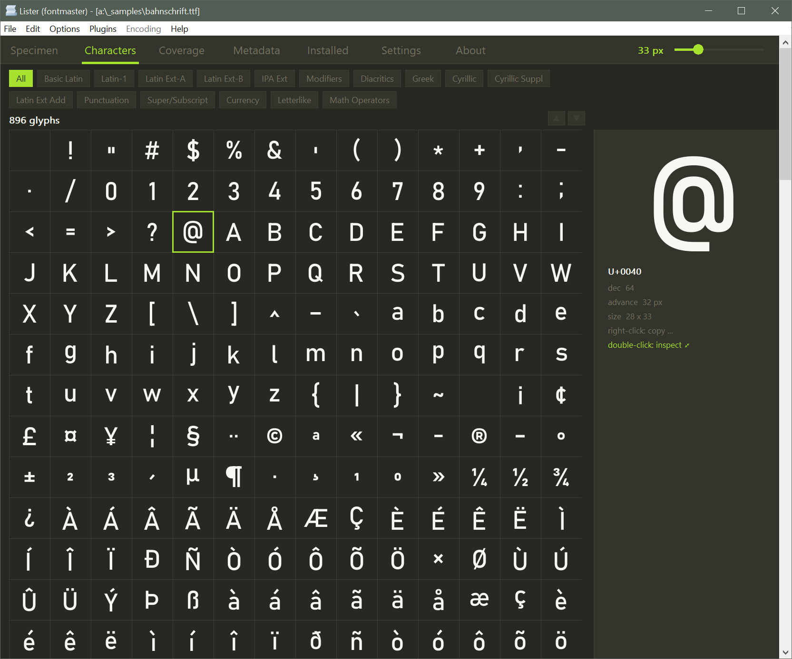
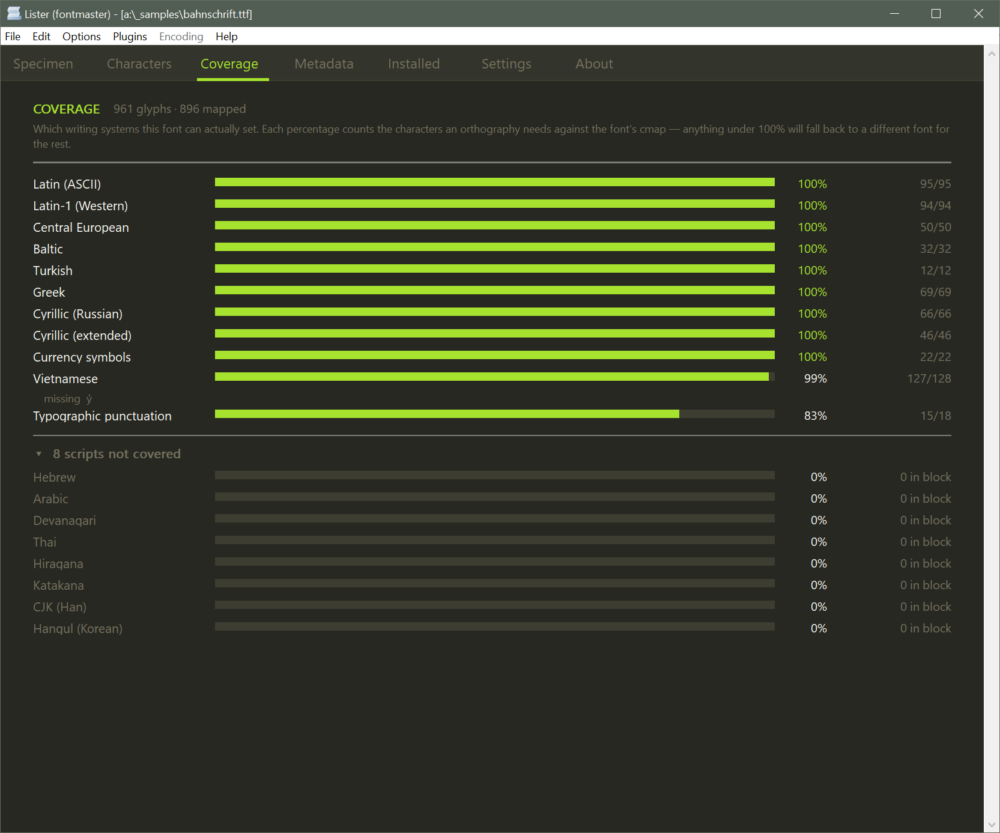
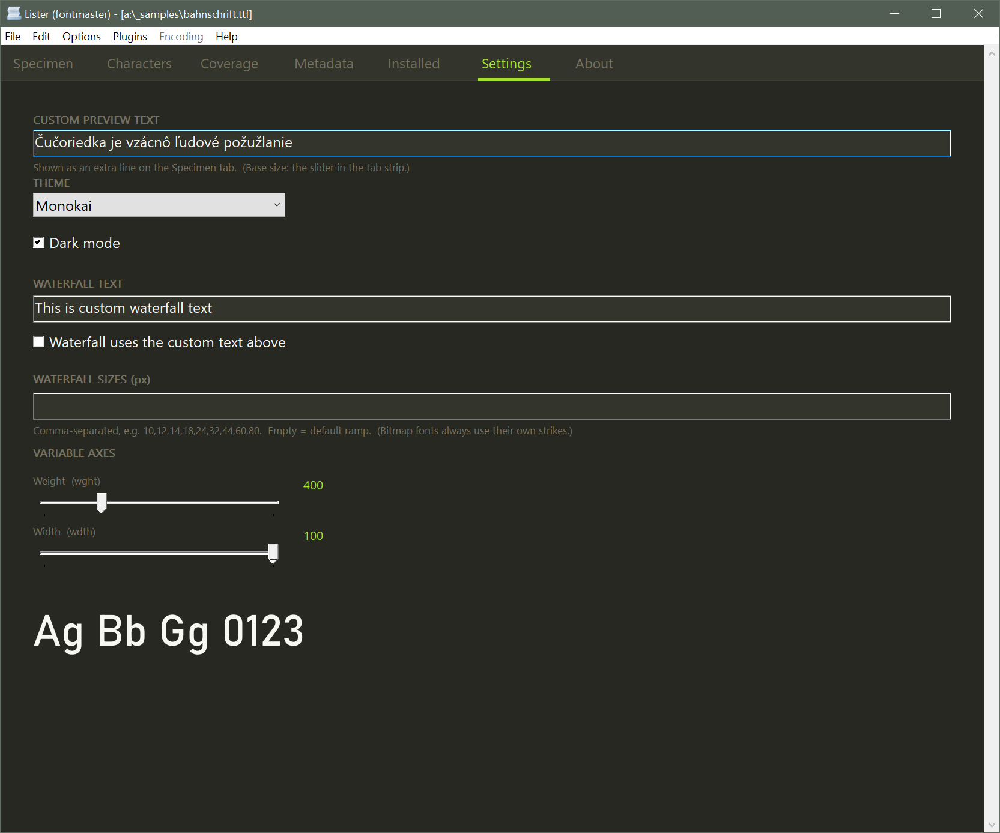
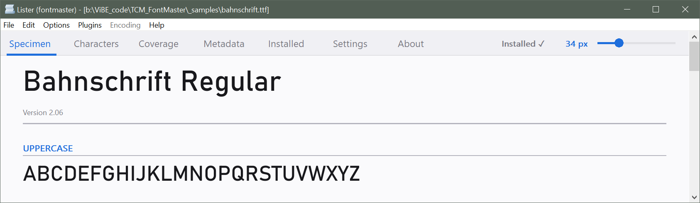
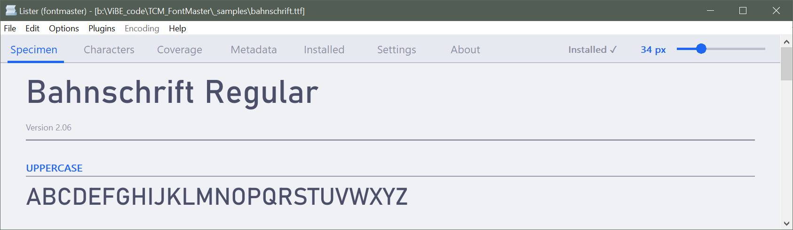
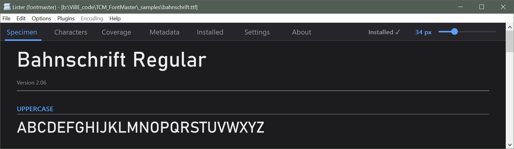
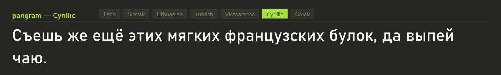

# FontMaster WLX Plugin

**FontMaster** is a modern Total Commander Lister plugin that brings font previewing directly into your file manager. Instead of opening a separate font viewer application, you can now preview fonts instantly as you browse your files - fast, clean, and built right into the workflow.

## New in version 1.9
- **FontMaster.exe - use it without Total Commander.** One file, nothing to install: run `FontMaster.exe font.ttf`, pick it in Explorer's *Open with*, or start it and choose a font. Drop another font on the window to switch, `Ctrl+O` opens one, `Esc` closes. All themes are built in (`FontMaster-x86.exe` for 32-bit Windows)
- **Colour emoji fonts** - gradient emoji fonts (COLR v1, e.g. Noto Color Emoji) now render, with emoji character-set chips, a Coverage row and a sample line
- **Bitmap emoji fonts** (CBDT / sbix) render at any size, and **OpenType-SVG** fonts whose glyphs are pictures show their colour artwork
- **Variable fonts on the Specimen tab** - named-instance chips (Light, Bold, Condensed...) and axis sliders sit right above the samples, with a reset chip
- **Export a glyph** - right-click any character: *Export outline as SVG file...* or *Export as PNG file...* (PNG keeps colour and transparency, so it works for emoji too). The save dialog remembers its folder, or set a fixed one with `ExportDir` in `FontMaster.ini`
- **More copy formats** - character, `U+XXXX`, Unicode name, glyph name, glyph ID, HTML entity, CSS escape, UTF-8 bytes, SVG outline, PNG image and a ready `@font-face` rule
- **Unicode character names** in the Characters detail panel
- **Glyph IDs view** - the last chip on the Characters tab lists every glyph in the font, including ligatures and alternates that have no character of their own
- **OpenType features and font checks** - Metadata > Advanced lists the font's GSUB/GPOS features (with stylistic-set names) and flags common problems such as mismatched line-spacing metrics or a wrong monospace flag
- **File position** - the strip shows the file name and `12 / 340` next to the `‹ ›` buttons
- **Glyph inspector** - `←` / `→` step to the neighbouring glyph, `Esc` goes back to the grid instead of closing Lister, and colour/emoji glyphs are shown
- **Faster with huge fonts** - big CJK and emoji fonts draw in steps instead of freezing the window, even at 4K
- **Settings tab scrolls** - every option is reachable in a short pane
- **Version in the file properties** of `FontMaster.wlx64` / `.wlx`

**Fixes**
- OpenType-SVG fonts with vector glyphs showed nothing; they now show their outlines
- Smooth-scrolling mice and touchpads did not scroll at all
- The Characters grid puts glyphs on a common baseline - comma and apostrophe no longer look the same
- Install / Uninstall on the second face of a `.ttc` collection
- Wrapped specimen lines no longer run past the right edge

### Previously, in 1.8
- **Uninstall, activate, show in Explorer** - the Install button is now a menu: install for your user, *activate until reboot* without installing, uninstall fonts you installed, or jump to the installed file. Right-click on the Installed tab does the same for system fonts
- **Filter on the Installed tab** - type part of a name instead of scrolling through hundreds of families
- **Go to a character** - type `U+20AC`, `20AC` or just `€` in the Characters tab and it jumps there
- **Kerning** - text in the specimen now uses the font's pair kerning (`AV`, `To`, ...)
- **Big fonts open much faster** - large CJK collections are read only as far as needed, and stay deletable while previewed

**Fixes**
- Installing a second style of the same family (e.g. Bold after Regular) no longer replaces the first one, and other styles of an installed family can be installed at all
- Custom texts longer than ~1000 characters, or with leading/trailing spaces, are no longer cut when saved
- Two Lister windows open at once no longer undo each other's settings
- `FontMaster.ini` now lists every option with a short explanation

### Previously, in 1.7.1
- **Web font support** - `.woff` and `.woff2` files now preview like any other format
- **Next / previous font buttons** - the `‹ ›` pair in the top-right walks the font files in the current folder, however Lister was opened. `Ctrl+,` / `Ctrl+.` and `Alt+←` / `Alt+→` do the same from the keyboard
- **`Ctrl+Q` cycles the character-set chips** on the Characters tab (`Ctrl+Shift+Q` steps back)
- **Optional: Page Up / Page Down switch font** instead of scrolling - a checkbox in Settings, off by default

### Previously, in 1.6
- **Keyboard navigation in the Characters grid** - arrow keys move the selection, Enter opens the glyph inspector, PageUp/PageDown page through the grid
- **Two more themes** - Rosé Pine Dawn (light) and Kanagawa (dark)
- **Pick your own Auto theme pair** - choose which light theme and which dark theme "Auto" switches between, instead of being stuck with plain Light/Dark
- **Simplified *and* Traditional Chinese pangrams** - fonts covering only one of the two now get a sample they can actually render
- **Fixed garbled metadata** on fonts with corrupted name records - some fonts showed their family, version and copyright as CJK gibberish

### Previously, in 1.5
- Glyph Inspector (double-click on glyphs)
- Pangram automatic variations to different sets, both for font, and installed fonts
- Coverage shows what writing systems this font supports

## What You Get

FontMaster is designed around one core idea: make font browsing a natural part of file management. Whether you're organizing design assets, exploring a font collection, or just checking if a font matches your needs, everything you want to know is right there without leaving Total Commander.

### Key Features

- **Live Preview**: See your fonts rendered in real-time as you navigate
- **Multi-face Support**: If a font file contains multiple typefaces (like TrueType collections), switch between them with a single click
- **Character & Glyph Inspector**: Browse every glyph the font contains, see coverage across different writing systems, and even inspect individual glyphs with a zoom view
- **Smart Specimen Samples**: Pre-built sample text for each script (Latin, Cyrillic, CJK, Arabic, etc.), with the ability to write custom preview text
- **Font Metadata**: All the details in one place - family name, style, version, licensing, and technical information
- **System Font Browser**: Check what fonts are already installed on your system and compare them side by side
- **Themes**: Choose from Light, Dark, or several carefully-selected popular themes (GitHub Light, Catppuccin, Monokai, and more)
- **Variable Font Support**: Pick a named instance or drag the axes right on the Specimen tab to see how weight, width, and other parameters change the look
- **Glyph Export**: Save any glyph as an SVG outline or a PNG image, or copy it in a dozen formats
- **Per-User Installation**: Install, uninstall or temporarily activate fonts for your user account directly from the plugin - no administrator access needed

### Supported Font Formats

FontMaster works with all the main desktop font formats:

- TrueType (.ttf)
- OpenType (.otf)
- TrueType Collections (.ttc)
- Type 1 (.pfb with .pfm)
- Bitmap fonts (.fon, .fnt)
- Web fonts (.woff, .woff2)

Web fonts preview exactly like any other format — handy if you're checking what a downloaded webfont actually looks like before using it. They can't be installed, though: Windows itself won't accept a `.woff2`, so the Install button stays away for those.

And it's available in both **64-bit and 32-bit versions**, so even older Windows systems are supported.

---

## Feature Walkthrough

### Specimen Preview

The specimen tab shows the font in actual use with sample text in various scripts - uppercase, lowercase, numbers, symbols, and language-specific samples. If you have a favorite preview text you want to use instead, you can set that in Settings and it will appear here. The text wraps naturally and shows you exactly how the font will look in real documents.

### Character Grid

Browse every single character in the font through an organized grid. You can navigate by Unicode blocks (Latin, Cyrillic, Greek, etc.) and see at a glance which characters are included. Click any character to see details, and if you want to dig deeper into how a specific glyph is drawn, you can double-click to open the glyph inspector.

### Glyph Inspector

For designers and font developers, the glyph inspector shows the precise outlines of individual characters. You get a pixel-perfect view of the shape, metrics, and construction of each glyph - useful when you're evaluating font quality or need to understand how a particular character is designed. Use `←` / `→` to step through the glyphs and `Esc` (or Backspace) to go back to the grid.

Right-click a glyph - in the grid or in the inspector - to copy it in many formats or to **export it as an SVG or PNG file**. The save dialog opens in the folder you last exported to; to always start in one folder, set `ExportDir` in `FontMaster.ini`.

### Coverage View

Not all fonts support all languages. The coverage tab shows you exactly what writing systems this font supports - Latin, Cyrillic, Greek, Arabic, CJK, and more. You get both the percentage of coverage for each script and a helpful list of any missing characters, so you know exactly what's included and what isn't.

### Metadata & Advanced Info

Everything you'd want to know about the font is collected here. Family name, style, version, copyright, designer information, licensing terms - it's all organized into clear sections. For designers and developers, there's also an Advanced view with technical details from the font file itself. URLs in the metadata are clickable, making it easy to visit a font's website or designer page.

### Installed Fonts Browser

Want to see how this font compares to what you already have? The Installed tab lets you browse all the fonts on your system in a dropdown, and preview each one the same way. You can also install new fonts directly from here - just click the Install button and it adds the font to your user account (no admin required).

### Settings & Customization

The Settings tab keeps everything flexible. Write your own custom specimen text (useful if you're testing how a font looks with your specific words), set your own waterfall text and sizes, pick your theme and which themes Auto uses in light and dark mode, and choose whether Page Up/Down switch fonts. Variable-font axes live on the Specimen tab. The preview size itself lives on the slider in the tab strip (or Ctrl + mouse wheel, Ctrl + +/-).

Everything is also stored in `FontMaster.ini` (next to the plugin, or in `%APPDATA%\FontMaster\` when that folder is read-only). The file lists every option with a one-line explanation, so it can be edited by hand; changes apply to the next Lister window you open.

### Multi-face Fonts

Some font files contain multiple typefaces. When you open a font like this, you'll see a chip in the top-right showing which face you're viewing. Use the left and right arrows (or Ctrl+PageUp/PageDown) to step through the faces. All the tabs update to show data for the currently selected face.

---

## Themes

FontMaster includes a carefully curated selection of themes to match your workflow and environment. Beyond the classic Light and Dark modes, you get plenty of community favourites - and since every one of them is just a small text file, nothing stops you from editing them or adding your own.

All fifteen live as small JSON files in the `themes/` folder next to the plugin, so you can tweak any of them in a text editor - or drop in your own. Each file just names six colours; restart Lister and it shows up in the picker.

**Available themes:**

- Light
- Dark
- GitHub Light
- Catppuccin Latte
- Rosé Pine Dawn
- Catppuccin Mocha
- Monokai
- Kanagawa
- Solarized Light
- Solarized Dark
- Nord
- Dracula
- Gruvbox Dark
- One Dark
- Tokyo Night

### Few Themes samples

Clean and readable, with high contrast for working in bright environments.

**GitHub Light** brings the familiar aesthetic of GitHub's interface - calm blues and grays that feel modern and approachable.

**Catppuccin Latte** is a warm, pastel light theme with excellent readability and a cozy feel.

Perfect for evening work or dark environments, with reduced eye strain.

**Monokai** is a dark theme with bold, vibrant accent colors - popular with developers who spend time in text editors.

**Catppuccin Mocha** and **Solarized Dark** are also available, offering different takes on dark-mode aesthetics.

All themes automatically sync with your Windows dark mode setting, or you can lock in a specific theme in Settings.

---

## Custom Specimen Text & Pangram Selection

By default, FontMaster shows intelligent, script-aware sample text - the specimen automatically picks samples in the language that best demonstrates the font's coverage (Latin, Cyrillic, Arabic, CJK, etc.). But you're not locked into defaults. 

In the **Specimen tab**, you can see a row of script chips next to "pangram" - click any chip to switch what language sample is shown. Or if you want to test how your font looks with your own text (your company name, a design slogan, whatever), just set **Custom Text** in Settings and it appears in the specimen instead.

The same feature works on the **Installed Fonts** tab - when you're browsing system fonts, you get the same script chips and custom text control, so you can compare how different fonts render your text.

---

## Keyboard Shortcuts

| Key | What it does |
|---|---|
| `Ctrl+Tab` | Next tab (`Ctrl+Shift+Tab` for previous) |
| `↑` `↓` | Scroll |
| `PageUp` / `PageDown` | Scroll a full screen — or switch font, see below |
| `Ctrl+PageUp` / `Ctrl+PageDown` | Previous / next face (multi-face fonts) |
| `Ctrl` + `+` / `-` | Preview size up / down |
| `Ctrl` + mouse wheel | Preview size up / down |
| `Ctrl+,` / `Ctrl+.` | Previous / next font in the folder |
| `Alt+←` / `Alt+→` | Previous / next font in the folder |

**Prefer PageUp/PageDown for changing font?** Settings has a *Navigation keys* checkbox: **Page Up / Page Down switch to the previous / next font**. With it on they walk the folder instead of scrolling. The **Characters** tab is the one exception — there they keep paging the glyph grid, because nothing else can, and the `‹ ›` buttons still work on every tab.

On the **Characters** tab the keys do a bit more: the arrow keys move the selection around the glyph grid instead of scrolling, `PageUp`/`PageDown` page through the grid, `Enter` opens the glyph inspector on the selected character, `←` / `→` step through glyphs inside it, and `Esc` or `Backspace` closes it again. `Ctrl+Q` steps through the character-set chips (`Ctrl+Shift+Q` goes back), which saves a trip to the mouse when the font has a lot of blocks.

---

## Behind the Scenes

FontMaster uses **FreeType** for rendering fonts and **DirectWrite** for accessing system fonts. Both are battle-tested libraries used across the industry, so you get reliable, accurate font previewing. The plugin is built natively for Windows with careful attention to performance - the preview is responsive even with large font collections.

---

## Version Info

This is FontMaster v1.9. Built with modern C++ and optimized for Windows 10+, with backward compatibility for Windows 8.1 and older systems (32-bit version).

Enjoy exploring your fonts! 🎨

